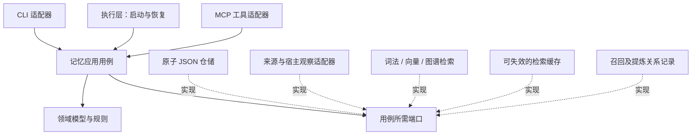

# 项目记忆与任务交接设计

[首页](index.html) · [当前架构](design.md) · [场景教程](walkthrough.md) · [命令参考](commands.md)

> 状态：M1 本地存储/审核/注入与 M2 交接/隔离提取已实现并通过受控测试；真实 Docker/模型验收仍待完成。M3 本地维护、显式共享与宿主 UID 受管审核已实现并通过受控测试。当前准确的命令和配置见 [项目记忆使用手册](project-memory.md)；下文未明确标注已落地的接口仍为目标契约。

## 0. 已采纳的模式与 M1–M3 实施边界

- **native**：个人默认，Codex 使用原生后台记忆，Claude 沿用原生记忆及既有同步。sbx 设置启动开关并保留会话关联，不接管原生生成文件的内部格式。
- **managed**：关闭 provider 原生自动记忆，由 sbx 选择已审核项目经验并保存、注入固定上下文。与组织受管模式相互独立。
- **off**：关闭原生自动记忆，不注入项目经验；不擦除旧会话内容。切换模式需要新会话，正在运行的会话需要先停止。

M1 使用宿主全局/workspace 配置和 Git flags，不新增 v2 TaskSpec 字段；通用任务仅使用宿主全局配置。组织执行默认 off、禁止 native；组织项目维护由固定管理员策略的 memory_reviewers 将宿主 UID 映射到 subject 与明确项目，审核绑定当前项目 sequence。原生记忆导入将按候选审核处理，尚未实现。

为简化崩溃一致性，M1 每个项目使用单个原子 JSON 保存完整修订，而非下面目标布局中的多文件索引；项目名作为稳定本地 ID。独立 task-memory 保存启动前快照，供 memory status 查询，尚未加入执行记录字段。数据 schema 与使用说明已发布。

M2 的实际入口是 `memory handoff <task>`、`extract <task>`、`job/jobs`、`processing <task>`、`recover <job>` 和 `retry <job>`，均有明确的 Git/general 命名空间。事实从持久化记录投影；目标/进度备注由操作者明确附加，模型说明与建议保存在提取作业。提取采用无工具的宿主 Responses/Messages API，复用可信配置的 provider API key，要求显式 model；不复用订阅会话，也不自动扫描日志或原生记忆。材料/输出/调用数与超时均有预算，输出只有候选权限。

自动提取默认关闭，显式启用后在 managed 同步 headless attempt 关闭、释放执行锁之后有界等待。独立 processing/job 记录失败，不改变业务终态。冻结作业保存在 `$SBX_HOME/memory-extractions/<id>/job.json`，交接、人工备注与 processing 在 task-memory 下；尚无提取守护进程或原生导入桥。更广的 Source/产物摘要选择仍是后续目标。

M3 在单个项目原子历史上提供 inspect/stats/check、review-due/renew 与显式 export/import；无独立索引，当前视图从校验后的历史重建，权威记录损坏时报错。共享包只含显式选中的经验与摘要，来源不继承审核权限，导入始终为候选；重放不覆盖本地审核。受管审核基于管理员绑定的宿主 UID，并记录组织与策略摘要，防止 --reviewer 冒用；这是可信本机维护边界，不是中心身份或抗宿主篡改的签名服务。组织模型提取和任务备注修改仍禁止，项目审核权限不包含任务数据外发。准确契约见手册第 10 节。

## 1. 背景与目标

目前 sbx 为 Codex 保存 task 对应的会话 ID，并在后续启动时使用该 ID 恢复会话。Codex 历史保存在共享 `sbx-home` 卷；Git 任务 done 后，任务状态与会话关联被删除，共享卷中的历史可能仍然存在。现有 `sbx memory pull` 是 Claude 项目自动记忆的宿主机同步入口，没有提供跨 provider 的项目知识管理。

本设计补齐两个能力：任务中断后有可检查的交接记录；新任务能够使用其他任务积累并经审核的项目经验。项目记忆由 sbx 管理，对 Codex、Claude 提供相同的选择、审核、版本与清理语义。

目标：

- 经验具有明确的项目范围、适用条件、来源和验证依据。
- 新任务只读取获准使用的知识，并记录实际使用的版本。
- 失败、取消、清理、崩溃恢复不丢失已持久化的知识，也不触发业务重放。
- 个人使用先在本地闭环；团队共享通过显式导出、审核、导入逐步扩展。

第一版不包含向量数据库、跨机器实时同步、中心记忆服务、自动修改项目规范或无审核的自动入库。记忆不保存凭据，也不提供外部业务操作授权。

## 2. 信息分层与权威边界

| 信息 | 内容 | 范围与主要用途 | 管理者 |
|---|---|---|---|
| 会话历史 | 对话、工具调用、上下文 | 同一会话继续执行 | Provider；sbx 保存关联 |
| 任务交接记录 | 目标、进度、未完成事项、验证结果、恢复入口 | task / attempt 的接手与恢复 | sbx |
| 项目记忆 | 测试方法、环境条件、稳定约束、已确认的故障经验 | 后续任务复用 | sbx 项目记忆服务 |
| 项目规范 | AGENTS.md、设计文档、团队规则 | 明确约束与确认决策 | 仓库及其评审流程 |

“还剩两个测试失败”属于交接；“集成测试依赖 PostgreSQL”可以成为经验候选。任务成功不代表其总结都正确；失败任务也可能产生有依据的经验。

记忆注入为带来源的参考资料，不能覆盖操作者指令、组织策略、工具授权或当前项目规范。发现冲突时标记并提示核对，不自动覆盖任何一方。需要把经验提升为规范时，另行提交仓库文档变更。

## 3. 抽象与接入位置

```text
CLI / TaskSpec
    ↓ 当前准入与项目授权
execution.Service
    ├─ Source → ExecutionWorkspace
    ├─ ProjectResolver → MemorySelector → MemorySnapshot
    ├─ Provider ← 本次记忆上下文
    ├─ 现有执行 → 外部操作 / ArtifactSet → Evaluator → Sink
    └─ HandoffWriter → CandidateExtractor → 候选持久化
                                              ↓ 显式审核
                                       ProjectMemoryStore
```

| 组件 | 职责 | 禁止承担的职责 |
|---|---|---|
| ProjectResolver | 把任务绑定到获准的项目身份 | 根据 prompt 或远程 URL 自动授权 |
| ProjectMemoryStore | 条目、版本、审核历史、项目锁与原子保存 | 启动 Agent、提交外部业务写入 |
| MemorySelector | 按项目、路径、标签和预算选择条目 | 任意跨项目搜索、修改条目 |
| MemorySnapshot | 固定本次注入的正文、版本、来源及摘要 | 作为项目记忆的可写主库 |
| HandoffWriter | 汇总执行事实与尚待处理的事项 | 用模型总结代替运行结果 |
| CandidateExtractor | 从授权材料生成结构化候选 | 自行批准、提升组织权限 |
| Provider 适配 | 将统一上下文交给具体 Agent | 决定项目知识的可信等级 |

建议新增 `core/internal/projectmemory`，保留现有 `core/internal/memory` 的 Claude 同步职责。执行服务负责阶段编排，CLI 负责命令适配；不把新能力实现成仅在 CLI 返回前运行的脚本。

## 4. 项目身份与存储

项目使用 sbx 生成的稳定 ID，通过受信任的本地注册表绑定。Git 主仓库与其 worktree 解析到同一绑定；仓库迁移或重新 clone 后需要显式绑定。remote URL 仅作为提示，不作为身份或访问权限证明。

通用任务通过获准的项目引用绑定；没有绑定时不读取或写入项目记忆，仍可产生任务交接记录。团队共享时，本地项目与导入来源项目也必须显式映射。

```text
$SBX_HOME/
  project-memory/
    projects/<project-id>/
      project.json
      entries/<entry-id>/<revision>.json
      candidates/<candidate-id>.json
      reviews/<review-id>.json
      index.json
      lock
  task-memory/<task-key>/<attempt-id>/
    context.json
    context.md
    handoff.json
    extraction.json
```

新目录与当前 Claude 同步使用的 `$SBX_HOME/memory/<key>.json` 分离。任务侧目录由宿主管理，独立于可删除的 Git task 状态；通用任务记录保存相应引用，Git 便捷入口使用相同的辅助记录契约。

Agent 仅接收本次上下文，不挂载整个知识库。优先使用宿主生成的只读文件和启动提示引用；具体 provider 适配必须验证新会话与 resume 都能收到上下文，不覆盖仓库原有指令文件。共享 daemon / 共享身份卷的既有信任边界仍然成立，这一设计不提供互不信任租户之间的隔离。

## 5. 数据契约

### 5.1 项目记忆条目

建议独立 schema 标识为 `sbx.project-memory/v1`。以下为拟议示例：

```json
{
  "schema_version": "sbx.project-memory/v1",
  "id": "mem-001",
  "revision": 1,
  "project_id": "project-001",
  "kind": "testing",
  "title": "执行集成测试前检查 Docker",
  "content": "执行 core 的 Docker 集成测试前检查 daemon 可用；单元测试通过不能证明集成测试通过。",
  "applies_to": {"paths": ["core/**"], "tags": ["docker", "integration-test"]},
  "source": {"task_key": "task-001", "attempt_id": "attempt-001", "revision": "commit-or-input-digest"},
  "evidence": [{"kind": "test_result", "ref": "evidence-001", "digest": "sha256:..."}],
  "status": "approved",
  "review": {"reviewer": "operator", "reviewed_at": "2026-11-02T00:00:00Z", "reason": "已核对实际测试记录"},
  "created_at": "2026-11-02T00:00:00Z"
}
```

`kind` 第一版限定为 testing、environment、constraint、troubleshooting、workflow。来源支持多个任务；候选还应记录提取器版本、材料摘要和候选内容摘要。手动录入可以没有来源 task，但必须注明人工来源与审核理由。

正文应自包含，证据引用只允许 sbx 登记的材料标识，不接受候选自行声明的任意宿主文件路径。摘要证明材料绑定关系，不证明内容正确。证据被清理时保留引用与摘要，标记 unavailable，不伪称仍可复核。

### 5.2 任务交接记录

建议 schema 为 `sbx.task-handoff/v1`，至少包含：任务/attempt 身份、目标、已确认约束、完成事项、待办、验证事实、工作区与产物引用、未决操作引用、下一步建议、更新时间。

运行结果、测试结果、交付回执与 unknown 状态由执行记录投影生成。模型生成的说明与建议单独标记；不得改写事实字段。交接记录不保存凭据、完整工具响应或无边界的原始日志。

### 5.3 本次记忆快照

至少记录项目 ID、选择条件、预算、排序规则版本、所选条目 ID/版本/正文摘要、完整上下文摘要、创建时间和注入结果。快照不可变，内容由宿主保存；执行记录只保存安全引用和摘要，公共 JSONL 不输出记忆正文。

## 6. 读取与注入流程

1. 准入时解析当前项目绑定，核验操作者权限与组织上限。TaskSpec 只能选择已授权项目并收窄范围。
2. Source 准备完成后，根据任务显式路径、标签和关键词选择 approved 条目。没有路径信息时不臆测全仓适用；项目通用条目与路径限定条目分开匹配。
3. 先过滤已归档、已替代、超出授权和不满足环境条件的条目，再按明确的稳定规则排序；同分用 ID 排序。达到预算后按条目截断，不截成含义不完整的半条经验。
4. 第一版拟默认上限为 20 条、16 KiB UTF-8 正文，由宿主策略配置并可被任务收窄。这是字节预算，不宣称等价于 provider token 数。
5. 在启动 Agent 前持久化快照并校验摘要，再通过 provider 适配注入。空结果是合法状态。
6. 同一 attempt 的继续执行使用原快照；只核验、审核、交付、核对外部状态时不重新选记忆，也不重新运行 Agent。新 attempt 重新选择并生成新快照。

策略撤销优先于快照复用：在恢复 Agent 前重新核验项目权限与条目撤销状态；若原快照含已撤销内容，阻止恢复并要求显式创建新 attempt，不静默替换原快照。运行中已经读取的内容无法收回，应沿用当前受管执行的取消机制限制后续活动。

同一 Codex 会话可能已经包含旧知识，`--fresh` 也不等于关闭项目记忆。新会话和项目记忆启用状态是两个独立选择，需要分别显示。

## 7. 交接、提取与审核流程

### 7.1 何时生成

执行服务在可持久化的阶段边界更新交接记录；不只在 done 时生成。正常退出、验证失败、等待审核、取消和可恢复中断都应保存当前已知事实。SIGKILL 时由 recover 基于已有记录生成不完整交接，明确哪些信息缺失。

第一版自动提取默认关闭，手动触发；M2 启用后，操作者可配置在 attempt 关闭时自动生成候选。verify、approve、deliver、reconcile 更新证据时，可以显式重新提取，不自动重复整个提取过程。

### 7.2 使用哪些材料

默认使用任务声明的安全摘要、交接记录、验证结果和操作者允许的产物摘要。原始日志、会话历史和工具返回需要单独授权及大小限制。受 Source exclude 排除的材料不能通过扫描共享会话目录重新引入。

默认沿用任务已配置的 provider 与认证，通过有独立超时、成本限制的隔离提取调用生成结构化结果；不恢复业务会话，不授予业务写工具或任意宿主访问。材料作为不可信数据传入。提取所需模型调用会产生额外费用，自动提取必须显式启用。

凭据路径和已知敏感字段在输入选择阶段排除；脱敏只作为附加措施，不能保证任意文本均无秘密。输出经 schema、大小、来源引用检查后保存为 candidate；异常输出不能自动降级为可信正文。

### 7.3 状态与审核

```text
candidate → approved → superseded / archived
    └────→ rejected
```

修改候选正文后必须审核新的内容摘要。批准操作绑定候选摘要和项目当前版本，在项目锁内完成；并发更新导致版本不匹配时返回冲突。已批准条目正文不可原地覆盖，修订创建新版本；已有快照仍能追溯旧版本。

审核人标识在个人模式下是本地操作者声明，在受管模式下必须绑定管理员支持的身份；不能把任意 `--reviewer` 字符串视为已认证身份。

近似重复内容只提示合并。矛盾经验保留适用条件并进入人工处理，不自动按“最新”覆盖。approved 表示经过审核，不表示永久正确；依赖版本、路径变化或复核期限可使条目标记需复核并暂停自动选择。

## 8. 崩溃恢复、锁与结果语义

项目库使用独占项目锁、版本比较和原子文件替换；索引可从条目与审核记录重建。禁止持有项目锁进行模型调用，也不在模型等待期间阻塞任务管理锁。

提取作业状态为 pending、running、succeeded、failed、interrupted。幂等键至少绑定项目、task、attempt、材料摘要与提取器版本。同一作业重复提交返回已有候选；显式替换提取器版本或材料才创建新作业。

模型请求已发出但结果未持久化时，标记 interrupted，不宣称模型调用恰好一次；重试可能再次计费，但不能重复发布候选。提取重试只消费已冻结的材料，不运行原任务、工具写入或交付步骤。

记忆提取状态与执行、验证、交付结果分开。已完成任务的提取失败记录为后处理失败，并提供单独查询/重试入口，不改写业务终态或已有退出结果。启动前显式要求固定快照却无法读取时必须阻止启动；自动读取模式遇到损坏也应报错，不能静默当成无记忆。

## 9. 当前接口与后续扩展

当前可用：

```sh
sbx memory project create my-project
sbx memory project bind --project my-project --repo /path/to/repository
sbx memory handoff <task> --scope git --summary safe-summary.json
sbx memory extract <task> --project my-project --scope git
sbx memory jobs
sbx memory job <job-id>
sbx memory processing <task> --scope git
sbx memory recover <job-id>
sbx memory retry <job-id>
sbx memory candidates --project my-project
sbx memory approve <candidate-id> --project my-project \
  --digest <current-digest> --reviewer operator --reason "已核对依据"
```

完整限制、配置及拒绝/归档流程以 [使用手册](project-memory.md) 为准。Git 命名空间需位于对应仓库，通用任务使用 `--scope general`。所有提取条目仍为 candidate，来源引用不是独立验证。

M3 已实现 export/import、归一化重复/可能冲突提示、到期复核和宿主 UID 组织审核。导入验证结构、摘要和大小，仅生成本地候选并保存包/来源项目/条目摘要；为减少默认泄露，不导出源端审核身份与完整历史。摘要不认证发送者，语义近似匹配和签名共享尚未实现。

当前 TaskSpec 严格使用 `sbx.execution/v2`，记忆选择来自可信宿主配置和 Git flags；不支持在 TaskSpec 临时追加记忆字段。未来若增加项目授权/快照选择字段，需要同步决策协议版本、严格解码、schema、admit、策略和记录兼容性。不改变 `sbx memory pull` 的 Claude 同步语义。

## 10. 生命周期与保留策略

| 操作 | 任务交接 / 快照 | 项目记忆 | Provider 历史 |
|---|---|---|---|
| stop / recover | 保留并更新可确认事实 | 保留 | 按 provider 现有机制保留 |
| 通用 task clean | 保留 | 保留 | 不隐式清理共享身份卷 |
| Git done / drop | 删除工作区前保留交接和会话引用摘要 | 保留 | 关联归档；不宣称删除历史 |
| prune 任务产物 | 保留摘要，缺失证据标记 unavailable | 不自动删除；标记复核状态 | 不受影响 |
| archive 记忆 | 旧快照可追溯 | 停止后续选择，保留修订 | 不受影响 |

第一版不自动物理删除项目记忆或会话历史。提供占用统计与独立的显式清理规划；已有快照引用的条目不能直接破坏性删除。需要因敏感信息紧急擦除时，单独执行有审计的擦除流程，并明确已注入的 provider 会话也可能包含副本，普通 archive 不等于擦除。

## 11. 使用场景

### 个人：一次排障帮助下一次任务

任务 A 发现测试依赖 Docker，交接记录保存测试失败和后续通过的证据。extract 生成候选，操作者核对后批准。任务 B 绑定同一项目并涉及 core 测试，启动时读取该条目；status 能说明注入了哪条、哪个版本。任务 A done 后该经验仍然存在。

### 团队：评审后共享经验

成员导出获准共享的条目，通过团队已有评审渠道审阅。另一成员显式映射项目并导入为候选，本地审核后使用。导出默认不含原始日志、宿主绝对路径、凭据或其他项目条目；第一版不声称提供中心权限分发。

### 基础设施：可重现的执行上下文

外部系统提交带获准项目引用和 pinned 选择的任务，执行记录保存快照摘要。复核时能重建当时的知识输入；项目授权被撤销则拒绝重新启动 Agent。记忆失败与业务失败分别上报，自动化不因提取失败重试外部写入。

## 12. 实施路线与验收

| 阶段 | 交付内容 | 必须通过的验收 |
|---|---|---|
| M1：受控存储与读取（已实现，受控验收） | 项目注册、手动候选/审核、版本存储、确定性选择、快照、两种 provider 注入、策略与协议适配 | 不串项目；新会话/resume 均注入；预算有效；撤销阻止恢复；done/clean 后仍保留；旧 Claude pull 不回归 |
| M2：任务自动沉淀（已实现，受控验收） | 交接投影、隔离提取调用、候选验证、幂等作业、成本限制、恢复与状态查询 | 失败任务可提取；SIGKILL 后交接诚实；重试不重放 Agent/外部写；额外模型调用可控；候选不自动批准 |
| M3：维护与共享（已实现，受控验收） | 重复/冲突提示、过期复核、归档、导入导出、占用统计、受管审核身份 | 并发审核不覆盖；历史校验后推导当前视图，无独立索引；不可信导入无越权；导出排除私有元数据，正文需显式检查；旧快照可追溯 |

每阶段都应交付实现、对应 schema/协议说明、命令帮助、场景教程和验收证据。重点测试项目绑定与路径边界、并发版本冲突、崩溃点、来源摘要绑定、撤销和清理语义；provider 适配使用受控实现验证，再执行真实 Codex/Claude 的最小新会话与恢复验收，区分受控测试与真实环境结果。

建议按 M1 → M2 → M3 推进。M1 先证明“已确认经验能准确、安全地被后续任务使用”，再增加模型自动提取，最后扩展共享与长期治理。

## 13. 后续优化提案：类型、检索与知识提炼

本节最初为 2026-11-11 的设计提案；其中 M4–M5 的结构化经验、本地检索、显式条件与人工反馈现已实现，运行中召回、规则/skill 草稿及语义检索仍待实施。详细契约见使用手册第 12 节，验收边界见本节末链接。参考[《M07 记忆系统与 Agentic RAG》](https://liwenzhou.com/courses/ai-agent/07-memory-agentic-rag/)对工作、情节、语义、程序记忆的区分，以及按需检索和检索质量评估思路；以下是结合 sbx 当前代码提出的适配方案，并非文章现成实现。

### 13.1 分开表示内容类型、审核状态与权威

现有 kind 是 testing / environment / constraint / troubleshooting / workflow，表达主题；candidate / approved 等表达审核生命周期。两者均不表示从经历到 skill 的成熟度，也不应被重新解释。

后续可增加独立的内容类型：

| 类型 | sbx 中的内容 | 后续处理 |
|---|---|---|
| 工作上下文 | 当前任务目标、计划、临时观察 | 由会话与交接管理，不全量写入项目记忆 |
| 情节经验 | 某次任务的条件、操作、结果与证据 | 保存可追溯事件摘要，支持检索相似案例 |
| 语义知识 | 经审核的环境事实、接口条件、稳定项目知识 | 按适用范围选择，并检查来源是否变化 |
| 程序知识 | 有触发条件的操作步骤、排障方法、验证与退出条件 | 可作为后续 skill 草稿的来源 |

这是逻辑分类，不要求新建四套存储。rule 和 skill 另有发布与授权边界：项目规则由仓库评审确认；skill 是独立版本化产物。程序性记忆不自动等于可执行 skill，approved 不等于组织规则。

建议的提炼关系：

```text
任务经历与证据 → 候选经验 → 已审核记忆
                              ├→ 仓库规则变更草稿 → 独立评审
                              └→ Skill 草稿 → 行为验证与版本化发布
```

一次有明确证据的失败也能产生有效经验；重复次数、任务成功、模型确信程度都不能单独替代证据审核。

### 13.2 提高经验正文的结构质量

候选提取可按需补充：适用条件、触发症状、采取动作、实际观察、验证结论、反例或未知项。区分“这次有效的办法”与“已证明的根因”，避免把单次绕过方法写成通用规则。

例如“prep 成功但 task 缺依赖”应保留安装目录、WORKDIR、mask、镜像或输入身份、容器内观察和最终验证。只有构建 exit 0 时，不能提炼出“依赖已经可供 task 使用”。材料不足时记录未知项，不生成虚假完整因果链。

结构化来源与适用字段需要 schema 版本和旧条目兼容设计；先用候选正文约定及夹具验证收益，不直接要求修改所有历史条目。

### 13.3 优先改进相关度选择，再考虑向量检索

M4 之前的 Store.Select 仅过滤审核、期限、路径与标签，再按 ID 顺序装入预算。当前已实现有界 query、词法相关度、选择解释和显式条件过滤；无 query 保留 ID 顺序，尚无 embedding 或语义排序。

建议先建立可解释的本地检索：

1. 按可信项目绑定、操作者权限、审核状态、有效期及适用条件确定可读集合。
2. 支持任务问题 / 错误码 / 命令 / 模块名的关键词召回，结合路径、标签计算相关度；保留精确标识符匹配。
3. 明确排序规则版本，同分按 ID 稳定排序；在完整条目与字节预算内选择，并记录入选原因及因预算落选的数量。
4. 通过评测确认同义表达漏召回后，再增加可选语义检索和结果融合；重排同样按收益、延迟和成本决定是否启用。

索引只能是可重建的派生数据，不替代原子 JSON 历史。索引结果绑定条目 ID、revision、digest 及索引版本；返回正文前从权威存储复核权限和当前状态。不得先跨项目检索或把无权正文发给外部 embedding / rerank 服务后再过滤。

小规模项目可以先扫描已授权条目，不必新增向量数据库。GraphRAG、HyDE 和重型索引不列为首批依赖。

### 13.4 固定启动快照与受控的按需召回并存

保留 attempt 启动时的不可变快照。后续可提供只读的项目记忆查询能力，让 agent 在出现新症状、缺少关键环境信息时补查；已有信息充足或请求与记忆无关时不查。

查询只能使用任务已绑定的项目和获准范围。调用次数、单次返回大小、总注入字节和执行超时由宿主限制；模型决定查询词，不能决定授权或自行扩预算。预算耗尽或结果不足时明确返回，不无限改写查询。

每次补充召回保存独立不可变记录，关联 attempt、查询条件、选择器版本、条目版本和摘要；不修改原启动快照。恢复时复用已登记的补充材料，并重新检查授权及撤销；不静默重新检索不同内容。公共事件不输出可能含敏感内容的查询或正文。

该能力涉及 provider 工具接入、运行中权限检查和恢复语义，不应仅在启动前 selector 内塞入一个循环就视作完成。当前没有对应新增命令或工具。

### 13.5 适用性与反馈独立治理

当前已有 review_due / renew、替代、归档及证据不可用等治理。下一步优先增加关键依赖版本、相关配置摘要或源码依据的变更检测，触发“需要复核”；不能仅因记忆最近被读取就延长有效期。

“语义知识”也可能随版本过期，不能因为类型是事实就永久有效。低频但关键的约束不应因访问次数少被自动删除。对原始材料、案例摘要、已审核事实及已发布 skill 分别制定保留和复核策略。

反馈可区分：检索命中、实际注入、操作者确认有帮助、验证支持、被反例否定。任务成功不自动归功于全部注入记忆；命中次数不改变 approved 状态或规则权威。冲突进入复核，保留来源和历史。

由记忆生成规则 / skill 时保留来源条目、revision、digest、适用条件和验证记录。来源后续被撤销或证伪，应提示下游产物复核；不静默改写已发布 skill 或自动执行新步骤。

### 13.6 分阶段实施与验收

| 优先级 | 建议交付 | 验收重点 |
|---|---|---|
| P1 | 经验提取结构、内容类型设计、关键词相关度与选择解释 | 主题 / 类型 / 状态互不混淆；精确错误码命中；预算内优先选择相关条目 |
| P1 | 适用条件变更检测与小型评测集 | 旧版本经验不误用；失败经验不被过滤掉；跨项目和未审核内容不泄漏 |
| P2 | 有预算的只读查询、补充快照与恢复 | 不改写原快照；撤销仍有效；达到预算能诚实停止 |
| P2 | 规则 / skill 草稿及来源关系 | 独立审核与发布；来源撤销可提示复核；不自动获得执行授权 |
| P3 | 按测量结果选择语义检索、融合或重排 | 对比现有基线确有收益；外部处理获授权；成本和延迟受限 |

评测集应包含：已知故障复用、同义问法、错误码精确匹配、无关记忆干扰、配置变更、冲突、过期、跨项目、空结果和恢复。比较相关条目召回、无关上下文占比、来源可追溯性、错误经验采纳情况、字节消耗、延迟及额外模型调用。检索质量与最终任务成功分别测量，不仅验证“能返回若干条”。

## 14. 后续优化实施清单

本清单承接第 13 节，阶段编号延续已实现的 M1–M3。M4–M5 已交付本地实现及受控验收，勾选对应已完成范围；涉及真实模型质量或运行环境的效果仍需独立验证。M4–M5 为首批，M6 与 M7 在相关基础完成后分别推进，M8 由测量结果决定是否启动。

### M4：结构化经验与相关度检索

目标：先解决“经验描述不完整”和“相关经验未优先进入上下文”，不增加外部模型调用或向量服务。

- [x] M4-01：建立不少于 30 个脱敏或合成案例的基线评测集，覆盖第 13.6 节的十类场景；标注应召回条目、不得返回条目、适用环境和可接受的空结果。
- [x] M4-02：记录当前选择器在固定预算下的召回、无关上下文占比、延迟和字节消耗；将开发调参集与最终验收集分开，冻结验收输入与版本。
- [x] M4-03：确定内容类型字段与兼容策略，保留 kind 和 status 原语义；旧条目保留“未分类”或明确的兼容值，不自动把历史 workflow 升为 skill。
- [x] M4-04：完善提取输出与手工录入契约，按需表达适用条件、症状、动作、观察、验证和未知项；材料不支持的字段允许缺省，不要求模型补全因果关系。
- [x] M4-05：同步输入/输出 schema、大小限制、内容摘要、存储修订与旧数据读取测试；修改提取模板时记录提取器版本。
- [x] M4-06：为只读选择增加有界 query 输入，明确宿主配置、Git 入口、provider 与协议的接入位置；不先向 TaskSpec 增加未经设计的字段。
- [x] M4-07：实现授权集合内的本地关键词相关度选择，处理错误码、命令和模块名，结合路径/标签；保持审核、期限、权限过滤先于返回正文。
- [x] M4-08：记录选择器版本、入选原因、条目 revision/digest 和预算落选摘要；同分稳定排序，保留无 query 时的明确兼容行为。
- [x] M4-09：通过精确标识符、同义表达、噪声、空结果、跨项目、超长 query、预算边界和旧快照兼容测试；同时更新命令帮助与手册。

交付物：兼容的数据契约、结构化候选示例、本地检索与选择解释、基线和对比报告。退出条件：在同一验收集和预算下，相关度指标优于 ID 顺序基线，隐私/权限及追溯检查全部通过；检索本身不新增模型调用。若未改善，保留可复现结果，不宣称阶段收益达成。

### M5：适用性检测与效果反馈

目标：识别“以前正确、现在未必适用”的经验，避免把使用频率当成可信度。

- [x] M5-01：定义可核验的适用条件及来源绑定，例如依赖版本、指定配置摘要和源码依据；限制在获授权材料内，不扫描任意宿主文件。
- [x] M5-02：区分条件满足、不满足、无法核验；确定缺少版本或来源材料时的保守行为，并使 CLI / 状态说明可见。
- [x] M5-03：实现变化触发复核和自动选择排除；将本次适用性结果与条目原审核状态分开，不静默删除或篡改 approved 历史。
- [x] M5-04：与 review_due、renew、supersedes、证据 unavailable 和撤销检查衔接；恢复继续遵守原快照及授权规则。
- [x] M5-05：定义命中、注入、人工确认有帮助、验证支持、反例等反馈事件，记录任务/条目版本；不因任务成功而给所有记忆记为成功。
- [x] M5-06：增加脱敏的检查视图，解释条目未选中或需复核的原因；统计不向公共事件泄漏正文和私人路径。
- [x] M5-07：验证锁文件/配置变化、来源消失、冲突、低频关键约束、过期与复核；确保重复读取不会自动延长审核期限。

交付物：适用性结果、复核提示、反馈记录和对比案例。退出条件：标注为不适用的条目不会进入新上下文，未知条件不会被伪称已满足；旧历史仍可追溯。条件无法核验时是否允许作为显式参考，需要事先确定策略并单独显示，不能混进自动有效集合。

M4–M5 当前实现限定：内容类型与经验结构均为兼容可选字段；requires 只做可信本机事实的等值比较及显式输入文件摘要比较；人工反馈是声明，不是自动质量判定。变化检测在选择/启动/恢复时执行，不在运行中持续监听。30 个合成案例、恢复与边界测试等证据见 [M4–M5 使用说明与效果边界](project-memory.md#125-验收边界)。

### M6：执行中的有界只读召回

依赖 M4 的选择器和 M5 的适用性检查。目标：任务出现新症状时补充资料，同时保留执行可恢复性。

实施前先按第 16 节收敛领域边界和公共查询入口。MCP 是适配器；CLI、启动快照和运行中查询复用记忆应用用例，不能各自实现审核、适用性和预算规则。

- [x] M6-01：设计 provider 可调用的只读查询契约，项目身份和最大范围由宿主固定；agent 只能提供有界查询及收窄条件。
- [x] M6-02：实现调用数、单次/累计字节、超时与任务总成本上限，并定义空结果、预算耗尽、撤销和检索失败的返回状态。
- [x] M6-03：对每次实际返回并交付给 agent 的材料登记独立不可变召回记录，绑定 attempt、选择条件、条目版本、摘要与调用结果；不改写启动快照。
- [x] M6-04：明确记录写入与交付之间的崩溃恢复顺序，避免未登记材料被使用；恢复复用原材料，不因重新查询而悄悄更换证据。
- [x] M6-05：在查询、返回及恢复时复核授权和撤销；处理运行中已读内容不可收回的边界。
- [ ] M6-06：Codex / Claude 受控 MCP 与新会话/恢复适配已通过，Codex 真实容器验收通过。用户明确要求保持 Claude 禁用，因此 Claude 真实新会话/恢复未验收；不以 Codex 结果替代。
- [x] M6-07：验证新症状补查、多轮无结果、预算耗尽、并发查询、权限撤销及故障恢复；确认简单任务可以不触发额外召回。

交付物：只读查询能力、补充召回记录、状态展示、provider 接入与恢复证据。退出条件：可解释地补齐任务中途所需资料；重复恢复不重置预算、不替换既有证据、不绕过撤销。仅有工具 schema 或离线 selector 不算完成。

### M7：从经验到规则 / Skill 草稿

依赖 M4 的经验结构和 M5 的来源有效性；不强制依赖 M6。目标：让重复验证的方法进入可维护产物，而非自动获得执行权限。

- [x] M7-01：定义规则草稿和 skill 草稿两种目标，明确适用条件、触发方式、步骤、验证、退出条件、限制及来源关系。
- [x] M7-02：支持显式选择已审核来源条目，绑定 ID / revision / digest；草稿生成只使用获准材料，并标明未知条件和相互冲突的来源。
- [x] M7-03：输出到用户指定的仓库草稿位置，不直接改生效的 AGENTS.md、不自动安装 skill、不自动提交或发布。
- [x] M7-04：建立来源与产物的关系记录；记录产物版本及审核证据，来源被撤销、证伪或替代时提示下游复核，不静默重写已发布文件。
- [x] M7-05：规则进入仓库评审；skill 使用隔离项目执行代表性行为验收，并检查命令能力、依赖、权限和版本契约。
- [x] M7-06：真实 CLI 示例、隔离 prep 行为测试与用户独立人工审核已完成，审核回执绑定精确来源与产物摘要。只记录审核；未安装或发布，Docker 构建、私网和现场根因仍未验证。

交付物：可审阅草稿、来源关系、审核/验证记录。退出条件：能从证据追溯到产物；生成不等于批准，批准不等于发布；失效来源能触发复核提示。无需凑够固定次数才允许提炼，也不以重复次数取代验证。

### M8：按需增加语义检索与重排

启动条件：M4 的对比报告证明存在可稳定复现的词义不匹配或规模瓶颈，并明确待改善的验收子集。

- [ ] M8-01：比较本地词法改进、可选 embedding、融合和重排，先确定外部处理授权、运维与成本边界，再选择方案。
- [ ] M8-02：设计可重建索引，绑定权威条目版本、内容摘要、模型/分词器版本及索引状态；更新、撤销与重建不能使旧正文继续被返回。
- [ ] M8-03：保证授权过滤与返回前权威复核，隔离不同项目；向外部服务提交材料前完成授权，不依赖结果阶段过滤弥补越权。
- [ ] M8-04：在冻结验收集上与 M4 比较召回、精度、延迟和成本；结果无收益或服务不可用时可回退本地检索，并显示能力降级。
- [ ] M8-05：验证索引丢失、滞后、旧 revision、模型升级、外部超时与预算耗尽；同步实际数据保留、删除与重建说明。

交付物：选型和对比报告；仅在收益成立时交付可选实现。退出条件：改善已明确的问题子集，关键场景无不可接受退化，权限与来源一致性不退步。GraphRAG 和 HyDE 不作为默认交付要求。

### 阶段记录要求

每项实现记录代码/文档位置、测试输入身份、命令、结果、实际环境和剩余限制。分别标记“已实现”“受控验证”“真实 provider 验证”“真实 Docker / 私网验证”，不以勾选替代证据。建议先完成 M4–M5，再决定 M6 / M7 的投入顺序；M8 可以保持不启动。

## 15. 效果设想与验证方法

以下是目标体验及可检验假设，不是性能承诺或已测结果。不预设召回率、耗时或成功率会提升多少；先取得 M4 基线，再用同一输入、授权范围和预算对比。

### 15.1 用户可感知的变化

| 场景 | 当前能力与局限 | 预期体验 | 验证方式 |
|---|---|---|---|
| 相似故障再次出现 | 路径/标签筛选可复用经验，但没有问题相关度排序 | 给出当前症状后，优先看到对应方法和来源，不被同目录无关经验挤出预算 | 在加入大量无关条目的夹具中检查相关条目的排名和入选 |
| 任务进行中才发现新错误 | 当前项目记忆由启动快照固定；本模块没有运行中查询工具 | 只在需要时补查，返回记录与具体条目版本可见，原快照保持不变 | 模拟新错误出现，检查召回记录、预算和恢复 |
| 项目升级后沿用旧经验 | 已有到期、替代和审核机制，尚无通用的依赖变化检测 | 自动选择前发现版本条件不符，说明原因，提醒复核或检查新代码 | 改变目标版本/配置，确认旧条目不再作为有效建议注入 |
| 有效办法被误当根因 | 当前正文与 kind 不强制区分观察、解释和验证 | 回答能明确“当时有效”“根因已验证”“仍未知”，不夸大证据 | 构造只有 workaround 的经历，检查提取和最终使用结果 |
| 同一方法反复由人解释 | 已有 workflow 类经验，尚无规则/skill 草稿链路 | 显式要求提炼后得到带来源、边界和验证步骤的草稿，评审后复用 | 完成一个从原始经历到草稿的追溯示例，检查未自动安装/发布 |
| 没有足够知识 | 空快照合法，但缺少问题相关度与补查反馈 | 明确说明未找到、条件未知或预算已用尽，转为调查当前项目或询问缺失条件 | 无答案和矛盾材料夹具；检查没有编造来源或无限重查 |

### 15.2 一条完整体验示例

1. 任务 A 遇到“prep build 成功，task 仍缺 Go 模块”。交接保留安装路径、镜像/输入身份和容器内验证结果。
2. 提取生成候选：动作是调整 GOMODCACHE；证据是新 task 内实际编译通过；若未定位为什么旧路径错误，根因仍标记未知。
3. 操作者审核后成为有适用条件的项目记忆。任务 B 处理相似症状时，相关度选择优先返回该经验及版本，不承诺直接套用一定成功。
4. 任务 B 检查当前项目后发现条件一致，再应用并验证；如果工具链或目录布局已变，则先复核，记录新的观察，不覆盖旧历史。
5. 用户要求“把这套检查加入配置 skill”时，生成 sbx-configure 改进草稿，引用来源条目和验证步骤，经独立评审和行为验收后发布。

这里希望减少的是重复调查和错误经验复用，而不是取消当前代码检查、人工审核或运行验证。

### 15.3 效果如何衡量

| 维度 | 建议测量 | 判定原则 |
|---|---|---|
| 找得对 | 相关条目 Recall@K、入选条目精度、空结果正确性 | 在冻结标注集上与当前 ID 顺序基线比较；无法回答的案例不强求非空 |
| 用得准 | 来源支持程度、已知错误经验采纳数、适用性误判 | 评审具体建议是否有证据；模型判断仅作辅助，不能自己给自己判满分 |
| 可追溯 | 注入/补查条目的 ID、revision、digest、选择器版本完整性 | 自动化验收样本全部可追溯；这不代表内容已被证明正确 |
| 有边界 | 越权返回、未审核/撤销内容返回、预算越界 | 受控边界测试中均为零；发现任何一次都阻止相应功能发布 |
| 成本 | 注入字节、额外模型调用、检索耗时和存储占用 | M4 检索不增加模型调用；后续按明确预算比较，不借增加上下文掩盖召回不足 |
| 实际帮助 | 操作者确认节省的重复操作、重复故障处理步骤、项目验证结果 | 使用配对案例和实际记录，不把所有成功归因于记忆 |

失败与边界案例单独报告，不只提供总体平均值。若没有达到效果，优先检查经验质量、适用范围和关键词召回，再决定是否增加语义模型。最终目标是更准确地找到并使用可验证的项目经验，而非增加记忆条数或检索次数。

## 16. 记忆领域边界与扩展设计

状态：公共查询入口及三个依赖端口已按 16.11 落地；其余为后续实施约束。运行中召回已按 16.12 落地；管理用例与 M7 已按 16.13 落地；缓存和图谱仍待测量后推进，不因预留接口而视作已实现。

### 16.1 领域范围：覆盖知识生命周期

当前已经完成的核心是受控知识存储、选择和快照；完整记忆领域还要覆盖如何产生、如何查、如何管理、如何改进和如何提炼。存储结构不是整个领域的边界，MCP、向量数据库也不定义领域。

| 能力 | 领域责任 | 当前与后续 |
|---|---|---|
| 采集与提取 | 接收任务事实投影、显式备注及导入材料，生成绑定来源的候选 | 已有 handoff / extraction；模型只是提取适配器 |
| 知识治理 | 候选、摘要绑定审核、替代、归档、到期复核、冲突和来源有效性 | 已有多数基础；继续收敛生命周期用例 |
| 查询与召回 | 查询理解、范围约束、多路候选、有效性复核、排序、预算和解释 | 已有词法选择；M6 增加运行中消费与恢复 |
| 使用与反馈 | 冻结交付材料、记录消费边界，接收有帮助/反例等反馈并触发复核 | 已有快照和人工反馈；召回记录及管理闭环待补 |
| 知识提炼 | 显式选择已审核来源，生成 rule / skill 草稿并维护来源关系 | M7；评审、生效和发布保持独立 |
| 检索加速与关联 | 缓存、全文/向量索引、知识图谱和重排 | 派生能力，按测量接入，不取得审核权威 |

这些是同一领域内的职责划分，不要求拆成多个微服务或数据库。第一步仍是在同一 sbx 进程中提供可测试的应用用例。

### 16.2 当前代码中需要收敛的边界

- 原 `projectmemory.Store` 混合文件路径/锁/原子保存、审核状态与版本规则、选择与预算。查询和快照校验现已转交 QueryService；存储和管理写入继续保留既有原子实现。
- `projectmemory/evidence.go` 中的提取作业布局知识已封装到 FileEvidenceResolver；查询服务通过 EvidenceResolver 消费来源状态，不了解该文件布局。适配器仍在原包，暂不整体搬迁目录。
- `execution/project_memory.go` 已处理启动、恢复与快照冻结；执行层应继续拥有 task 生命周期，但记忆有效性和选择规则应通过公共记忆用例执行。
- `toolgate.Selection` / `Authorizer` / `Reader` 目前针对 `records.get` 和外部记录 grant；不能仅给 Kind 加一个字符串，就把知识库查询强塞进外部记录模型。
- `internal/memory` 是 Claude 原生记忆同步，`taskmemory` 是任务交接及提取，`projectmemory` 是已审核项目知识。三者需要明确职责，不因名称接近就合并存储或混用权威。

已有的 provider 无关数据模型、原子历史、摘要绑定审核和冻结快照保留。重构不重写旧 JSON 或改动历史摘要，也不把执行记录的事实权威转交给记忆模块。

### 16.3 目标依赖方向



领域层不导入 Docker、Codex、Claude、MCP、HTTP、TaskSpec 或具体数据库类型。执行适配器把 task/attempt 转成记忆所需的消费身份；模型适配器接收显式材料，不自行浏览执行记录或 provider 历史。

用已有 `projectmemory` 模型逐步收敛领域规则。本阶段 QueryService 留在原包并通过端口隔离；后续用例数量和迁移收益明确时，可再将应用编排放入 `memoryapp`、将文件存储和检索实现放入基础设施包。不先整体搬目录；旧 Store API 在迁移期作为兼容入口。CLI/MCP 的 wire DTO 与内部领域类型分开演进，现有 schema 和 digest 编码保持兼容。

### 16.4 应用用例与最小端口

公共入口按行为命名，不提供一个任意读写的万能 MemoryManager：

| 用例组 | 建议行为 | 关键区别 |
|---|---|---|
| Knowledge | SubmitCandidate、Review、Supersede、Archive、Renew | 维护审核历史；写入检查预期 sequence/digest |
| Query | Search、FreezeSnapshot、ValidateSnapshot | Search 只查询；Freeze 明确持久化；Validate 不重新选择 |
| Recall | Recall、RestoreRecall | 绑定消费会话/attempt、预算及不可变交付材料 |
| Maintenance | Inspect、RecordFeedback、ListReviewFindings | 反馈是声明；发现需复核不等于自动改变 approved |
| Curation | CreateDraft、InspectSourceRelations | M7 的来源绑定与草稿，不拥有发布权限 |

第一批仅在真实依赖边界引入小接口：

- **KnowledgeRepository**：读取有 sequence 的一致性视图，以及带预期版本的原子提交；项目历史仍是权威。不要拆成独立可失败的“改条目状态”和“写审核事件”。
- **EvidenceResolver / ObservationProvider**：解析明确的来源引用或宿主选定的观察范围，返回状态及绑定摘要；不接受模型提供的任意宿主路径或命令。
- **Retriever**：从本次已获准的候选集合中召回/排序，输出条目 ID / revision / digest、分数、理由与策略版本；不决定审核、权限和是否向 agent 交付。
- **RecallLedger**：持久化预算预留、冻结响应及后续交付观察，支持幂等请求和恢复；与启动快照分开。

提取已有 Model 接口应继续使用，不为不同模型复制提取状态机。M7 出现实际需求后再引入草稿生成器和产物写入适配器；缓存作为检索装饰器或专用缓存实现，图谱作为候选检索/关联实现，不提前为每个可能的组件建一套框架。

### 16.5 “如何查”：统一查询流水线

CLI、启动选择和 MCP 查询复用以下流程：

1. 宿主解析消费身份、项目绑定、当前授权及最大范围，形成不可由模型扩大的查询上下文。
2. 校验并规范化查询、路径/标签收窄条件和预算。保留错误码/模块名的精确语义；改写后的查询同样有大小与调用预算。
3. 从权威视图确定项目/权限范围内的条目，获取明确的事实观察及来源状态，再按审核、期限、来源和适用性排除不合格候选。
4. 按查询计划调用词法、全文、向量或图谱策略，并按需融合/重排；第一版仍只用已有词法实现。授权过滤先于向外部服务提交正文。
5. 将检索引用与权威条目核对：ID、revision、digest 必须匹配；返回前复核授权、撤销、期限、来源和适用条件。引用过期时剔除或返回需重试，不悄悄换成新版本。
6. 按完整条目、条数和实际字节预算组织响应，返回命中理由及空结果/条件未知/预算耗尽等明确状态。
7. 根据调用用例决定是否冻结材料：离线 Search 不写；启动快照和 M6 Recall 在相应记录持久化成功后才允许交付。

查询文本属于潜在敏感材料，检索解释也可能泄露条目身份；公开事件只放允许的计数和引用，不能默认记录 query 正文或范围外条目。

MCP 的 proposed `memory.search` 只解码查询、调用 Recall 用例和编码响应。它不自行打开 JSON 文件、判断 approved、检查来源或更新管理状态。CLI 的 Search 与 MCP 的 Recall 可复用检索规则，但后者有消费记录、累计预算和恢复要求，不能直接把 CLI JSON 原样透传就视为 M6 完成。

### 16.6 “如何管理”：闭环与事实边界

```text
执行事实投影 / 显式材料 → 冻结提取材料 → 候选
                                      ↓ 人工审核
                                 已审核项目知识
                                      ↓ 查询 / 使用
                                  反馈与新证据
                                      ↓
                 需复核事项 → 更新候选 / renew / 替代 / archive
                                      ↓ 显式选择
                               rule / skill 草稿
                                      ↓ 独立评审
                                   生效或发布
```

“需复核”首先是维护视图中的发现及有效性结果，不要求立刻增加存储状态或静默改写 approved。来源消失、条件变化、冲突或到期，按明确规则停止新选择并提示操作者；反馈不自动修改批准状态。

成功任务不证明记忆正确，失败任务也不证明全部记忆错误。重复、冲突、使用频率和模型置信度只提供审核线索。低频关键约束不按命中率自动删除。历史、提取材料、派生索引、交付记录和已发布产物分别确定保留策略；清理 task 运行资源不清理项目记忆。来源被归档可停止新使用，但不能声称擦除已读上下文。

M7 的产物与来源关系至少绑定来源 ID/revision/digest、草稿摘要及生成器版本。来源撤销后生成复核提示；既不自动重写发布文件，也不因产物存在而延长来源有效期。

### 16.7 缓存：加速派生计算，不缓存授权结论

需要区分两类检索缓存与一类冻结交付记录：

| 对象 | 复用收益 | 失效依据 |
|---|---|---|
| 条目分词、向量等特征 | 避免同一版本反复计算 | 条目 digest、分词/模型版本、处理参数 |
| 检索候选引用及排序 | 减少重复查询与融合成本 | 项目及授权范围指纹、语料 sequence、规范化 query、路径/标签、事实/来源指纹、策略/索引版本、相关预算 |
| 已冻结交付材料 | 恢复本次会话实际使用的内容 | 这是有生命周期的事实记录，不是可随时淘汰的缓存；复用仍检查当前授权和撤销 |

缓存内容留在相同的可信宿主边界，不把不同项目或操作者的 query 混用。向量/特征发送到外部缓存或 embedding 服务之前，也必须有相应材料外发授权。

即使命中缓存，交付前仍执行权威复核。项目 sequence 不足以感知提取来源文件被删除、watch 文件变化或时间越过 review_due；不能仅依赖 sequence 或 TTL。若缓存键缺少某类动态事实，就不能跳过对应复核。空结果可以短暂缓存，但不能遮蔽新审核、授权变化或事实变化；缓存不可用时可直接回源，失效项不能用旧正文兜底。

失效可由成功提交后通知加速，并由版本核对兜底，避免“JSON 已提交但缓存失效通知丢失”继续返回旧知识。初期不要求引入 Redis 或常驻服务；先测量查询耗时和热点，再选择进程内或本地持久缓存。

### 16.8 知识图谱：用于关联召回与来源追溯

知识图谱可先表达明确关系：经验适用于哪个依赖/版本、来源于哪些证据、替代哪个条目、支撑哪些草稿。节点和边必须绑定来源条目 revision/digest 以及关系提取器版本；模型推断关系保留候选/不确定属性，不能把“同时出现”升级成“根因导致”。

例如用户查询“升级 Go 后 prep 依赖失效”，图谱可以将 Go 版本、依赖缓存、prep 经验关联起来，输出需要进一步核对的条目引用，再由统一查询流程校验、排序及返回正文。它也可用于查看某条经验被撤销后有哪些草稿需要复核。

图谱是可重建的派生视图，不替代原子知识历史；任何图上命中均需权威复核。遍历过程受项目/授权范围、跳数、节点数、时间和返回字节约束，范围外节点及边不通过解释或计数泄漏。关系来源撤销、版本变化或图谱滞后时，旧边不能继续提供未经校验的正文；图谱不可用可回退已授权的词法查询。

第一阶段不选定图库、不默认建设 GraphRAG。先用明确的来源/替代/产物关系和冻结场景验证收益；若关系表或邻接索引足够，不引入独立图数据库。

### 16.9 M6 的传输、消费和崩溃边界

现有 ToolGateway 可复用 HTTP/MCP 解析、令牌认证、请求限制、代理路由和 provider 配置的经验，但其 records.get grant 与结果审计模型仍归外部记录工具。后续可抽取有类型的工具处理器注册点，由 records 适配器和 memory 适配器分别调用各自用例；不把记忆权限伪装成 external.Grant，也不暴露任意函数分派。

记忆应用层拥有召回预算及内容凭据，通道层拥有连接和响应写入观察，执行层拥有 task/attempt 及生命周期。三者通过明确引用衔接，不互相复制状态机。

一次 Recall 先预留预算，再检索并持久化冻结响应；持久化失败时不能向 agent 返回正文。重试由宿主绑定的幂等请求身份关联，不重新扣费或改变该次冻结条目。交付前再次授权复核，记录响应准备与写入观察；网络写成功也不等于模型已阅读，连接中断时保留交付未知状态。

恢复使用已登记材料并复核当前可用性；不得用缓存或重新检索悄悄替换原召回结果。跨知识仓储和 RecallLedger 不承诺一个尚未实现的全局事务，需明确预留、准备、交付和崩溃恢复顺序。M6 的具体状态、幂等键、预算结算与日志上限在实现前完成契约设计和故障注入验证。

### 16.10 分步实施与验收约束

- [x] D1：固定 EntryRef、Query、授权查询上下文、ObservedFacts、EvidenceState、Budget 和查询解释的契约；将已有规则划归明确责任。
- [x] D2：建立公共查询用例，先接当前 JSON 仓储和词法策略；CLI 与启动快照改走同一入口，保持旧 JSON、digest、无 query 排序和审核并发行为。
- [x] D3：将来源读取与文件观察通过适配器注入，消除 projectmemory 对提取作业文件布局的直接了解；拒绝来源未知时仍沿用当前保守行为。
- [x] D4：确定管理用例的版本并发、反馈及复核事项流程，不因接口拆分失去单次审核/替代的原子性。
- [x] D5：完成 M6 的 RecallLedger、预算和恢复契约，再接 MCP；不同时搬迁所有包或引入新数据库。
- [ ] D6：用第二种轻量检索实现或测试替身验证策略可替换、过期引用被拒绝、故障可退回词法；不要求先调用真实 embedding 服务。
- [ ] D7：基于测量实现最小缓存，验证审核/撤销、来源消失、事实变化、到期、权限变化和通知丢失时不返回失效正文。
- [ ] D8：M7 先保存来源—草稿关系，再用具体关联查询验证是否需要图谱实现；证明图谱丢失或滞后不会突破权威复核。

验收重点是更换入口、仓储或检索策略之后，批准、权限、来源、快照、恢复与清理语义仍成立。性能收益另行测量；接口数量、缓存命中率或图谱节点数不作为领域设计完成的依据。D1–D4 是下一轮领域收敛工作，D5 承接 M6；D7/D8 的实际缓存和图谱投入按测量决定，不阻塞最初的 MCP 召回闭环。

### 16.11 当前阶段实现与独立 cmd 预留

已确认方向：记忆是独立领域，未来可能提供单独的 cmd；当前继续在 sbx 进程内实现，不预先拆进程、发布第二个可执行程序或增加远程服务。

第一批代码位于 `core/internal/projectmemory/query.go`：

- QueryService 提供 `Search(ctx, project, Selection)`、`ValidateSnapshot` 和 `ValidateSnapshotFacts`，没有 Home、Docker、Codex、MCP 或 TaskSpec 依赖。
- ProjectReader 提供授权范围内的一致性项目视图；当前 StoreReader 复用 Store.Load 的校验及 AllowedProjects 限制。未来运行中授权变化仍由宿主/调用方提供能实时复核的读取适配器。
- EvidenceResolver 接收 host-generated Provenance，返回类型化 EvidenceState；默认 FileEvidenceResolver 处理现有提取作业文件格式。
- Retriever 只接收已通过范围、审核、期限、来源和条件检查的文本投影，返回 EntryRef（ID/revision/digest）、分数、命中词和策略版本；默认 LexicalRetriever 保留现有规则。
- 返回正文前重新读取权威项目视图和来源状态。未知、陈旧、重复或不在本次合格集合中的检索引用会被拒绝；新接口错误可通过 ErrInvalidRetrievalResult 分类，不要求传输层解析错误字符串。
- 空 query 不调用可替换策略，保留按 ID 选择的兼容行为。非空 query 的既有词法排序、解释及固定夹具摘要保持不变。

`Store.Queries()` 是 sbx 当前的组合入口；Store.Select / Check / CheckFacts 保留为兼容委托。CLI search、snapshot 和执行层启动/恢复已调用公共服务，执行层可传入取消上下文。Search 仍只读；Pin 等持久化及审核写操作保留原子边界，未为未来数据库虚构通用写接口。事实观察仍在宿主调用端完成，本轮不增加文件监视器或自动版本探测。

未来独立 cmd 可以重新组合这些适配器：

```go
queries := projectmemory.NewQueryService(
    projectmemory.StoreReader{Store: authorizedStore},
    projectmemory.FileEvidenceResolver{Home: knowledgeHome},
    projectmemory.LexicalRetriever{},
)
snapshot, err := queries.Search(ctx, projectID, selection)
```

新 cmd 自己负责 flags、可信配置、身份/授权和输出协议；不能从模型或不可信项目输入直接构造 unrestricted Store。它不需要构造 sbx task 或启动 Docker。若未来与 sbx 同时访问同一知识库，应继续共用并发锁、sequence/digest 及数据版本规则，不能形成两套审核权威。这里预留的是进程内 Go 接口，尚未承诺稳定的独立命令名或跨进程 RPC 协议。

本批验证：完整 `go test ./...`、projectmemory / taskmemory / execution / cli 的 race 检查及 `go vet ./...` 通过。固定无 query / E401 夹具在重构前后快照 digest 相同；替换检索器、旧/跨范围/重复引用、检索期间撤销、取消与来源适配器失败均有测试。没有据此声称已实现缓存、向量/图谱检索、M6 RecallLedger 或独立 cmd，也没有重跑真实模型容器验收。


### 16.12 M6 实施结果（2026-11-20）

新增 `projectmemory.RecallService` 与 `RecallLedger` 端口，直接组合 QueryService，仍无 Home、TaskSpec、Docker、MCP 或 provider 类型。`FileRecallLedger` 是可替换的宿主适配器，采用跨进程锁、原子文件替换和目录 fsync。保留未来独立 cmd 组合能力；本次没有新增独立可执行程序、缓存、图谱或数据库。

宿主 `[memory] recall=true` 启用注册式 MCP `memory_search`；输入只接受 key/query。启动快照和运行期召回分离，召回账本绑定 task、provider 会话、固定项目及启动范围。预算、状态、持久化顺序、幂等与恢复契约已落实在 [使用说明第 13 节](project-memory.md#13-运行中的只读召回m6)。查询/返回/恢复都复核当前授权、条目与来源、可信事实。组织模式在专门的动态记忆策略存在之前拒绝启用。

工具网关增加注册式只读处理器，原 records.get 外部授权语义不变。Git 和 general 同步 headless 共用接入；Codex/Claude 的传输与 launch/resume 有受控测试。真实 Codex 通过 web-go 容器、sbx-home 登录卷执行；用户要求 Claude 继续禁用，故其真实验收保留未完成。记录状态 `prepared_delivery_unknown` 不假称模型消费已经确认。已进入上下文的记忆无法撤回，恢复以所有冻结召回做保守复核。

测试覆盖新症状补查、无结果/不触发查询、同 key 重试与冲突、跨 attempt 预算、调用/字节/时间耗尽、并发预占、超时、账本持久化故障、预占崩溃、prepared 恢复、撤销、账本缺失/摘要损坏以及启动快照不变。具体命令、真实身份和验收范围见 [M6 验收记录](project-memory-m6-acceptance.md)。M7/M8 和其余领域治理抽象没有由此自动完成。


### 16.13 领域管理与 M7（2026-11-20）

D1/D3/D4 本批收敛：QueryContext/Query/QueryBudget/ObservedFacts 定义固定宿主范围及收窄契约，文件观察通过 ObservationProvider 注入；memoryio.ExtractionFiles 负责提取作业路径，领域只核对来源文档。KnowledgeRepository 提供带版本预期的原子更新，ManagementService 统一候选、审核、续期/替代/归档与反馈规则；FindingReview 将复核处理显式追加而不改变批准。旧 Store API、既有条目/快照摘要与原子审核语义保留。

M7 通过 CurationService / DraftGenerator / DraftLedger / DraftWriter 组合，支持两种草稿、精确来源冻结、文件保护、幂等写入恢复、摘要审核和来源—产物反查。默认生成器仅消费聊天中显式准备的计划，不追加模型调用；授权材料外发需由未来具体模型适配器负责。所有依赖端口仍可由未来独立 cmd 组合，未引入新可执行程序、服务、向量缓存或图库。

生产知识的批准、草稿审核和安装/发布保持独立。受控测试的 reviewer/validation 明确标作夹具声明，不冒充真实用户审核。来源撤销后动态提示复核，原文件与审核历史不改写；详见 [使用流程](project-memory.md#15-从经验生成-rule--skill-草稿m7) 和 [验收记录](project-memory-m7-acceptance.md)。
